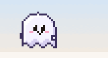
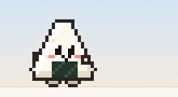
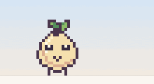
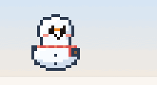
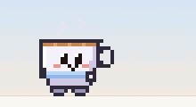

# Dot Buddy characters

English | [한국어](README.ko.md) | **[Browse the gallery](https://dot-buddy.github.io/characters/)**

Characters people drew for [Dot Buddy](https://github.com/doldoldol21/dot-buddy), the pixel desktop pet that tells you when your coding agent is done.

**Get one:** in the app, right-click the pet → Character → **More Characters…** and choose **Install**. Or download a zip from the [gallery](https://dot-buddy.github.io/characters/) and drop it on your pet; no need to unzip.

## Gallery

<!-- gallery:start -->
| | Character | By | License |
|---|---|---|---|
|  | **Ghost**<br>A friendly little ghost whose hem sways as it floats along. | [@doldoldol21](https://github.com/doldoldol21) | CC-BY-4.0 |
|  | **Rice Ball**<br>A rice ball in a seaweed wrap, ready for a long day of coding. | [@doldoldol21](https://github.com/doldoldol21) | CC-BY-4.0 |
|  | **Onion**<br>A rosy onion with a fresh green sprout and a sunny little smile. | [@GaneshUbale](https://github.com/GaneshUbale) | CC-BY-4.0 |
|  | **Snowman**<br>A snowman with a red scarf and a carrot nose. | [@doldoldol21](https://github.com/doldoldol21) | CC-BY-4.0 |
|  | **Teacup**<br>A little teacup that steams while it waits. | [@doldoldol21](https://github.com/doldoldol21) | CC-BY-4.0 |
<!-- gallery:end -->

## Artists

Thank you to everyone who drew a character for the gallery. Draw one and you'll be here too.

<!-- artists:start -->
<table><tr><td align="center"><a href="https://github.com/doldoldol21"><br><sub>doldoldol21</sub></a></td><td align="center"><a href="https://github.com/GaneshUbale"><br><sub>GaneshUbale</sub></a></td></tr></table>
<!-- artists:end -->

## Share your character

1. Draw a character pack as described in [CHARACTERS.md](https://github.com/doldoldol21/dot-buddy/blob/main/CHARACTERS.md). The gallery needs at least `idle`, `walk`, `work`, `sleep`, `ask` and `fall` (or `jump`); every motion you add makes it livelier.
2. Try it: drop the folder on your pet (or put it in your characters folder and choose **Reload Characters**).
3. Fork this repo and add the folder as `packs/<name>/`. The name is 2–32 characters of `a-z`, `0-9` and `-`, and can't be a built-in character's name (mandu, acorn, sprout, cloud, candle, pebble). One character per pull request, and nothing outside its folder.
4. Open a pull request. CI checks the pack, loads it in the app and attaches its preview (the `previews` artifact on the run). After the merge, CI draws the preview and adds it to the gallery, the site and the in-app list, and you to the [artists](#artists).

### chara.json

On top of the [usual keys](https://github.com/doldoldol21/dot-buddy/blob/main/CHARACTERS.md#charajson), a pack here needs three more:

```json
{
  "name": "Teacup",
  "names": { "en": "Teacup", "ko": "찻잔" },
  "author": "your-github-name",
  "license": "CC-BY-4.0",
  "description": "A little teacup that steams while it waits.",
  "descriptions": { "ko": "기다리는 동안 김이 모락모락 나는 작은 찻잔" }
}
```

Fan art also adds `"based_on": "Character (Series)"`.

| Key | Meaning |
|---|---|
| `author` | Your GitHub username (shown as "by …" and linked in the gallery) |
| `license` | The license for your drawings: `CC-BY-4.0`, `CC-BY-SA-4.0`, `CC0-1.0` or `MIT` |
| `description` | One short line, at most 140 characters (optional) |
| `descriptions` | The same line in other languages, e.g. `{"ko": "…"}` (optional; the app and the gallery show the one for the reader's language) |
| `based_on` | Fan art only: the character and series it's based on, at most 60 characters. Shown as "Fan art of …" |

### Rules

- **Draw it yourself.** Don't copy other people's sprites or art, and don't recolor another pack (CI compares outlines).
- **Official characters**  are the ones the Dot Buddy team drew. Other packs can't use their names or call themselves official, and a pack that looks like one (flipped, moved or resized too) waits for a maintainer to compare them.
- **Fan art is welcome** if you drew it and fill in `based_on`. The original character belongs to its owner; your `license` covers only your drawing.
- Only you can change your pack: CI checks that `author` is the GitHub account opening the pull request.
- Only `chara.json` and `<motion>.png` files (motion names are in [CHARACTERS.md](https://github.com/doldoldol21/dot-buddy/blob/main/CHARACTERS.md#motion-names)). No other files.
- Frames are at most 30×32 dots, every motion uses the same frame size, at most 16 frames per motion.
- Each file is at most 64 KB and the pack at most 512 KB. Pixel art is usually far smaller.
- Keep it friendly: no violent, sexual or hateful content.

Check a pack locally before opening the pull request:

```bash
python3 scripts/packs.py check                              # file names, sizes, chara.json, motions
python3 scripts/packs.py check --app <path to DotBuddy>     # also load it in the app
```

No drawing skills? Open a [character idea](https://github.com/dot-buddy/characters/issues/new?template=character_idea.yml) and someone may pick it up.

## Removing a character

We can't judge copyright for every character, so packs are taken down on request. If a pack uses your character or art, or breaks the rules above, [report it](https://github.com/dot-buddy/characters/issues/new?template=report_character.yml) and a maintainer will check and remove it from the gallery and the in-app list. Copies people already installed stay on their Macs. Authors can ask to remove their own pack the same way.

## How installing works

The app downloads `packs/index.json` from this repo only when you open **More Characters…**. Installing a pack downloads just the files the list names for it (`chara.json` and PNGs), checks each file's size and SHA-256 against the list, and puts the pack in your characters folder. Packs are images and a small JSON file, read with the same loader and limits as packs you add by hand.

## License

Each pack keeps the license its author chose (the `license` key in its `chara.json`). The scripts and site are MIT ([LICENSE](LICENSE)).
